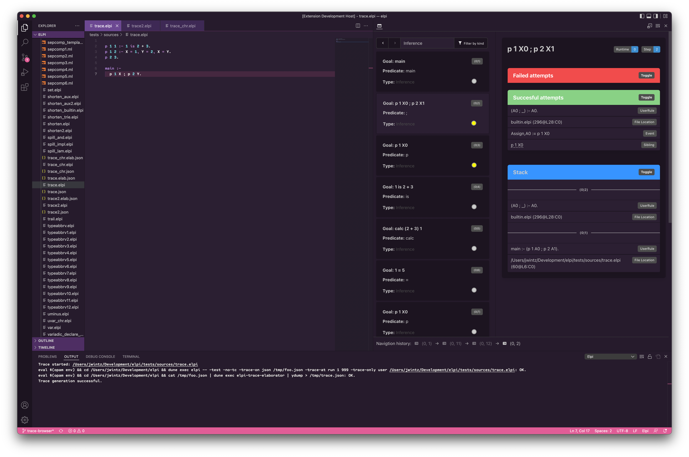

# elpi-lang

This extension provides support for the [Elpi](https://github.com/LPCIC/elpi) programming language to Visual Studio Code.

## Features

- Basic syntax highlighting
- Trace visualisation and navigation
- Diagnostics (all syntax errors, type errors, warnings), hover (types) and
  go to definition, provided by the `elpi-lsp` language server

## Requirements

- Node 1.18+
- VSCode 1.82+
- Elpi 1.16+
- `elpi-lsp` (opam package `elpi-lsp`, see the
  [language server](https://github.com/LPCIC/elpi/tree/master/lsp)) for the
  language server features

## Building for development

- `npm install`

## Running in development

- Open the source tree root in VS Code 1.82+
- Go to the extension panel in activity bar
- Click 'Run extension'

## Extension Settings

- `elpi-lsp.path`: path to the `elpi-lsp` executable (default: `elpi-lsp` in
  the `PATH`; a leading `~/` is expanded)
- `elpi-lsp.args`: extra command line arguments for the server
- `elpi-lsp.debug`: `off`, `messages` or `verbose`, traces the LSP
  messages in the *Elpi LSP Trace* output channel

Commands (command palette): *Elpi LSP: Restart server*, *Elpi LSP: Show output*.
After changing `elpi-lsp.path` or `elpi-lsp.args` the extension offers to
restart the server.

## Known Issues

- none

## Release Notes

See the [CHANGELOG](CHANGELOG.md) file
